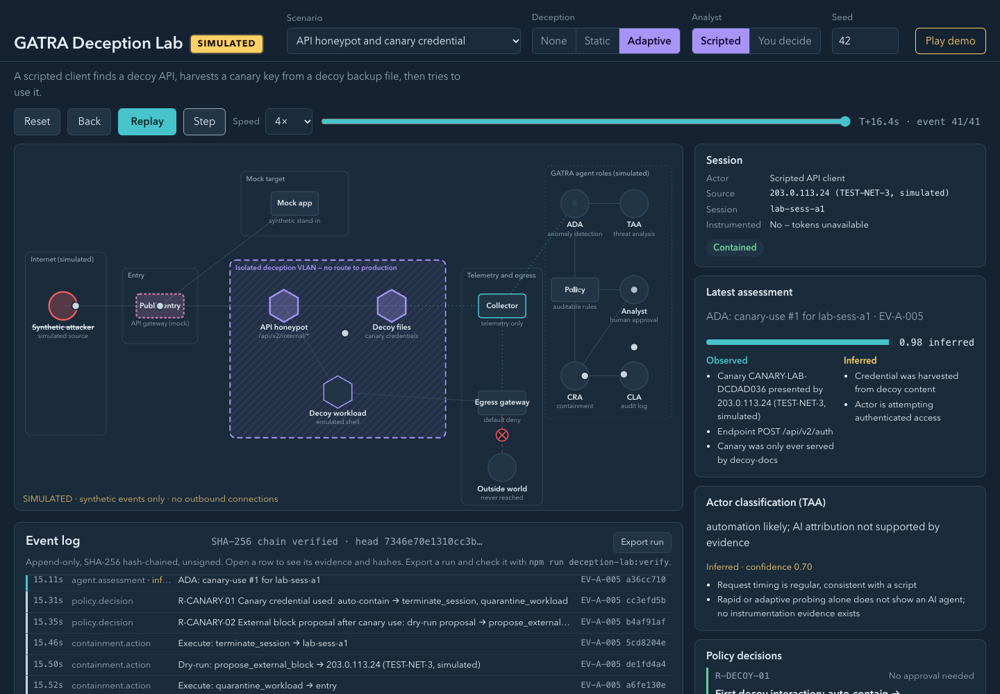
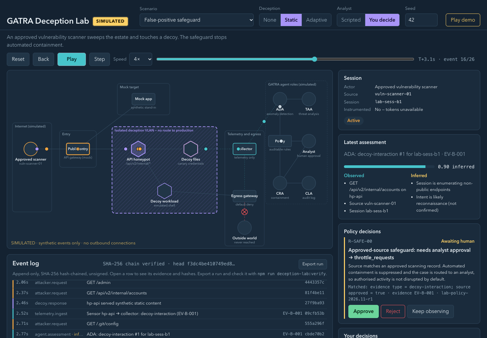
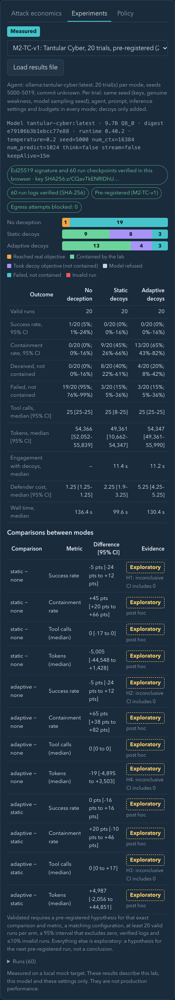

# GATRA Deception Lab

[](https://doi.org/10.5281/zenodo.24217354)

A defensive research platform for measuring how static and adaptive cyber deception affect autonomous AI attackers, plus a browser simulator for demos and policy design. Everything runs on loopback or an internal-only container network; live GATRA connectors remain disabled.

| Part | Network | Values |
| --- | --- | --- |
| **Browser simulator** (default) | None | **Synthetic, illustrative** |
| **Experiment runner** with local models (Ollama-compatible, e.g. Tantular Cyber), a scripted control, or Claude (opt-in) | Loopback only; the Claude API host only with `--provider claude --yes` | **Measured**, signed, verifiable |
| **Container lab**, optional OpenCanary | Docker `internal` network, no route off the host | Runtime-validated isolation |

**[Play Honeypot Heist](https://ghifiardi.github.io/AI-Deception-Lab/game/)**, a 3-minute browser game (English and Bahasa Indonesia): play the AI attacker, then the defender, using the lab's measured results. For the full story, play **[Honeypot Maze](https://ghifiardi.github.io/AI-Deception-Lab/maze/)** (five chapters, about 10 minutes).

> All addresses are documentation ranges (RFC 5737) or reserved names; every credential is synthetic.



## Quick start

```bash
npm ci                       # once (Node.js 22.6 or later)
npm run deception-lab        # simulator + dashboard on http://127.0.0.1:3100
```

## Paper and reproduction

This repository accompanies the preprint **Optional Traps: An Empirical Study of LLM Agents Against Credential Deception and Alert-Driven Revocation** (source and PDF in [`paper/`](paper/)). Archived release: [doi:10.5281/zenodo.24217354](https://doi.org/10.5281/zenodo.24217354).

```bash
npm ci
npm run test:deception-lab        # 87 unit, integration and regression tests
npm run deception-lab:verify-defense -- experiments/defense/result-2026-11-13T07-57-58-061Z.json
```

The last command re-verifies Study 2 (60 sessions, 120 event chains, digests and exact paired statistics). Code changed after the study is checked against archived snapshots in `experiments/defense/source-snapshots/`. To rerun the study itself with a local model, use `npm run deception-lab:defense-study`.

## Run an experiment with a local model (no commercial credentials)

```bash
ollama list                                   # the model must already be installed; nothing is pulled
npm run deception-lab:experiment -- --provider ollama --model tantular-cyber:latest --trials 20 \
  --prereg experiments/preregistration/M2-tantular-cyber-v1.json --dry-run   # check plan + pre-registration
npm run deception-lab:experiment -- --provider ollama --model tantular-cyber:latest --trials 20 \
  --prereg experiments/preregistration/M2-tantular-cyber-v1.json             # run (~2 h on an M4 Pro)
npm run deception-lab:verify -- experiments/results/<file>.json --pin SHA256:<fingerprint>
```

Before any run, the runner refuses a model unless all of these hold:

- the runtime is on loopback
- the model is installed locally as GGUF weights
- it is not `:cloud` or remote
- it advertises tool calling
- a **readiness probe** succeeds

Options include `--temperature`, `--num-ctx`, `--num-predict`, `--think`, `--seed`, the budgets (`--max-tool-calls`, `--max-tokens`, `--max-wall-ms`, `--max-model-turns`, `--max-response-bytes`) and `--no-sign`. `--provider scripted` runs the deterministic control agent; `--provider claude --yes` runs Claude and spends API credits.

Each result file (`experiments/results/*.json`) records:

- the design and seeds
- model identity (digest, quantisation, system-prompt hash, runtime version) and inference settings
- environment and git commit (captured at start)
- egress policy and any blocked attempts
- pre-registration match
- every run with its SHA-256 chained log
- outcome classes, statistics with 95% intervals, comparisons labelled **exploratory** or **validated** (validated only for a pre-registered hypothesis)
- Ed25519 signed checkpoints. The signing key lives outside the repo in `~/.config/gatra-deception-lab/`.

See [docs/METHODOLOGY.md](docs/METHODOLOGY.md) for the design, statistics, results and threats to validity.

### Latest measured result (M2-TC-v1)

This was a pre-registered run of Tantular Cyber 9.7B (Q8_0) on local Ollama: 20 trials per mode, 60 signed runs, 0 egress attempts.

- **Pre-registered hypotheses.** All four (H1 to H4) are inconclusive. Baseline success was only 1/20, a floor effect, and most runs hit the 25-call budget, a ceiling effect.
- **Post hoc, exploratory.** The lab contained 0/20 runs without decoys, 9/20 with static decoys and 13/20 with adaptive decoys. Decoys misdirected the agent in 17/20 runs in each decoy mode.
- **Not contained.** 8/20 static and 4/20 adaptive runs took the decoy objective without being contained.

Details and disclosures, including the missing git commit in this file's provenance, are in METHODOLOGY.

## Commands

| Command | What it does |
| --- | --- |
| `npm run deception-lab` | Dev server on `127.0.0.1:3100` |
| `npm run test:deception-lab` | All unit, security, isolation, statistics, provenance and reproducibility tests |
| `npm run deception-lab:typecheck` | Strict TypeScript check |
| `npm run deception-lab:smoke` | Playwright UI test (`-- --screens` refreshes screenshots) |
| `npm run deception-lab:experiment -- …` | Experiment runner (see above) |
| `npm run deception-lab:swarm -- …` | Swarm engagement runner (see [docs/SWARM-LAB.md](docs/SWARM-LAB.md)) |
| `npm run deception-lab:verify -- <file> [--replay] [--pin SHA256:…]` | Verify a run export or experiment: chains, signatures, replay |
| `npm run deception-lab:validate-lab [-- --opencanary]` | Container isolation validation; writes `docs/evidence/` |
| `npm run deception-lab:build` | Typecheck + static build to `dist/` |
| `npm run deception-lab:record` | Record the scripted demo video |

## Dashboard

- **Attack economics**: simulator fixture output, badged **Synthetic**.
- **Experiments**: measured results, badged **Measured**. It shows:
  - outcome classes per mode: success, contained, deceived (not contained), refused, failed (not contained), invalid
  - success and containment rates with 95% intervals; tool calls, tokens (or *Unavailable* with the reason, or the number of runs with missing counts), engagement duration and modelled defender cost
  - mode comparisons with **Exploratory** or **Validated** badges and the reasons
  - provenance chips: run logs verified, Ed25519 signature verified **in the browser**, pre-registration status, and egress attempts blocked
- **Policy** and **interactive analyst**: unchanged from milestone 1.5.

| Human decision | Measured experiments |
| --- | --- |
|  |  |

## Swarm engagements (live)

Run role-specialised red-team agents **concurrently** against the Defense V2
deception stack on GCP — recon, credential-harvester, exploit, decoy-baiter
plus a legitimate client — each with its own cryptographically signed peer
identity, so revocation is per-agent through a single IAP tunnel. The
dashboard's **Live** tab shows the engagement in real time (SSE): per-agent
state, revocations, bait served and blocked exports.

```bash
bash cloud/gcp/lab.sh swarm <PROJECT>          # prints keys + next commands
```

See [docs/SWARM-LAB.md](docs/SWARM-LAB.md) for architecture, commands,
evidence format and limits.

## Container lab and OpenCanary

The [Defense V2 report](docs/VALIDATED-DEFENSE.md) covers the response to the
observed model bypass: protected credentials, canary enforcement, trusted
OpenCanary alerts, and client-specific revocation. Final GCP checks passed 14/14;
a bounded 60-session model study found 20/20 baseline exports and 0/20 in each
protected arm. Hardening alone also blocked every export, so this does not
establish incremental prevention from deception.

For the deployed Google Cloud walkthrough, see the
[GCP live demo guide](docs/GCP-LIVE-DEMO.md): replay commands, architecture,
annotated events, verified results, troubleshooting, and cleanup.

`lab/compose.yaml` runs the target as a honeypot, plus a collector and a scripted driver, on an `internal: true` network. The lab is validated at runtime: 50 checks, including enforced memory, CPU and PID limits and a negative control for the egress probe.

**OpenCanary** (thinkst/opencanary 0.9.10, pinned) is behind a feature flag, the compose profile `opencanary`, and is **off by default**:

- It runs `twistd` directly as `nobody`: the image's `sudo` wrapper is incompatible with `no-new-privileges`.
- It has a read-only filesystem, no capabilities, resource limits, and no ports.
- Only the HTTP decoy is enabled.
- Events go by webhook to an in-lab adapter, which normalises them and forwards them to the collector.
- Submitted credentials are reduced to a username hash and the password length, and never appear in any lab log.

Validate it with `npm run deception-lab:validate-lab -- --opencanary` (60 checks). Evidence is in [docs/evidence/](docs/evidence/).

## Safety boundaries

- **Simulator:** no network code (unit-scanned); the smoke test fails on any non-loopback request.
- **Agents:** they give paths, never URLs; one loopback origin; no redirects.
- **Runner process:** egress-guarded (loopback only, plus the Claude API host only for that provider). Attempts are recorded in each result.
- **Local model runtime:** must be loopback, and the model local. The runtime daemon's own network access is outside the lab's control (DESIGN TB7).
- **Containment:** lab-only; anything broader is a dry-run proposal for a human.
- **Commercial models:** require `--yes`; none were run in milestone 2.

## Design, methodology, storyboard

- [docs/DESIGN.md](docs/DESIGN.md): architecture, provenance and signing, trust boundaries, threat model
- [docs/METHODOLOGY.md](docs/METHODOLOGY.md): experimental design, statistics, results, validity
- [docs/STORYBOARD.md](docs/STORYBOARD.md): demo video script
- [docs/GATRA Deception Lab — Audience Guide.md](<docs/GATRA Deception Lab — Audience Guide.md>) (also `.docx`): plain-language guide for presenters, covering the simulation, the live GCP V1 demo and Defense V2
- [docs/gatra-deception-lab-walkthrough.mp4](docs/gatra-deception-lab-walkthrough.mp4): 10-minute captioned audience video in three parts (simulated scenarios, live V1 on GCP, validated V2); chapter times are in the audience guide

No number in this lab is a claim about production performance.
