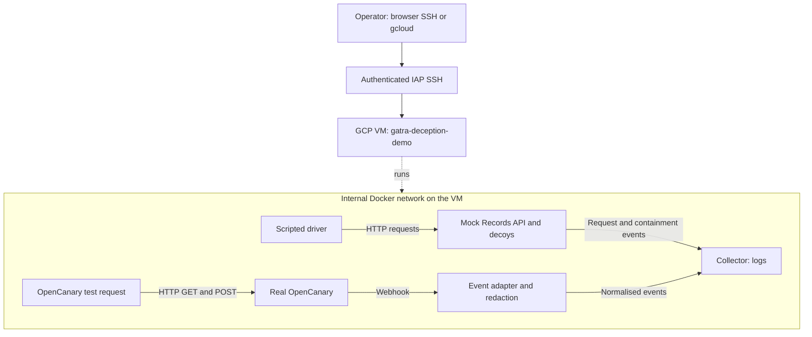
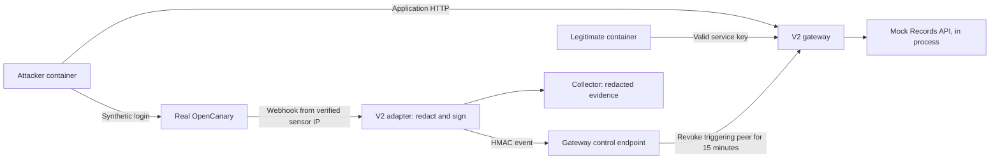

# GATRA Deception Lab — Audience Guide

Updated 13 November 2026 · @ghifi

This file is an export of the living Audience Guide. It has three parts: the guide itself, the **Live GCP demo (V1)**, and **Defense V2**. The detailed source reports are [GCP-LIVE-DEMO.md](GCP-LIVE-DEMO.md) and [VALIDATED-DEFENSE.md](VALIDATED-DEFENSE.md).

## Overview

The GATRA Deception Lab shows how planted fakes (decoys) turn a quiet break-in into a loud, early alarm, and how the response stays safely inside an isolated lab.

A synthetic attacker meets honeypots and decoys in a sealed network segment. Sensors report what they see, simulated GATRA agent roles assess it, written rules and (optionally) a human analyst decide, and a lab-only controller contains the attacker. Every step is written into a tamper-evident log.

**The one idea to take away:** real users never open a fake door. So when something does, the alarm is almost certainly right, and it rings before the attacker reaches anything real.

This guide goes with two shareable pieces:

- **The interactive simulation:** a playable map of the lab where you pick a scenario and a deception mode, and can make the analyst's decisions yourself.
- **The video walkthrough:** a captioned MP4 in three parts (the four simulated scenarios, the live V1 run on Google Cloud, and the validated V2 defense), made for presenting to audiences.

The same idea also ran live on Google Cloud on 13 November 2026, with real HTTP requests and a real OpenCanary honeypot. Its measured results are in [Live GCP demo (V1)](#live-gcp-demo-v1).

After a real AI agent bypassed that V1 demo, a hardened V2 gateway was built and validated: 14/14 checks on GCP and a 60-session local model study. See [Defense V2](#defense-v2).

The simulation and part 1 of the video are **simulated**. It uses documentation-only IP addresses (RFC 5737), fake credentials and illustrative numbers, and it never touches a production system.

## How it works in six steps

Every run follows the same six steps. The simulation highlights the current one as it plays.

1. **Knock on the door.** Someone probes the public entry. On its own this looks like any visitor, so nothing is blocked yet.
   - Analogy: a stranger trying door handles along a corridor.
2. **Take the bait.** The attacker opens a fake door: a hidden API, a backup file holding a fake key, or a decoy server. No real user needs these, so touching one is a near-certain sign of an intruder.
   - Analogy: a fake safe in a bank vault. Staff never open it, so whoever does is almost certainly a burglar.
   - A **canary credential** is a fake key with a tracker. It opens nothing, but the moment anyone uses it, we know who took it.
3. **Sensors notice.** Decoys and the egress gateway send telemetry only to a collector. Anomaly detection (ADA) scores it and threat analysis (TAA) links it to the session's earlier steps.
   - Decoys can only report out. They have no route to anything real, so the trap cannot become a stepping stone.
4. **Rules and a human decide.** A written, auditable rule (for example `R-CANARY-01`) proposes a response. Actions with real impact wait for an analyst to approve, reject or keep observing.
5. **Contain, inside the lab.** The containment role (CRA) runs lab-only actions: throttle, revoke the session, quarantine a workload, seal the egress gateway. Blocking at the real perimeter stays a dry-run proposal for a human.
   - Analogy: a building where every exit is locked unless it is on the list.
6. **Write it down for good.** The audit role (CLA) records each step in a hash chain. Each entry contains a fingerprint of the one before it, so changing any entry visibly breaks the chain, and the run can be replayed exactly.

## Reading the simulation

The map reads left to right, from the internet to the agents that decide. Each moving dot is one message, and its colour says who sent it.

| Zone (left to right) | What sits there |
| --- | --- |
| Internet (simulated) | The synthetic attacker, the approved scanner, or the lab harness running our own test agent |
| Entry | The public API gateway (mock) |
| Mock target | The real-target stand-in the attacker wants to reach |
| Isolated deception VLAN (hatched) | API honeypot, decoy files with canary credentials, decoy workload. No route to production |
| Telemetry and egress | The collector (telemetry only) and the default-deny egress gateway. The outside world is never reached |
| GATRA agent roles (simulated) | ADA, TAA, Policy, Analyst, CRA, CLA |

| Dot colour | Meaning |
| --- | --- |
| Orange | Attacker traffic |
| Teal | Telemetry from sensors |
| Light grey | Policy messages |
| Yellow | Analyst question or decision |
| Green | Containment action, or a legitimate client in V2 |
| Red | Denied connection |

Boxes change state as the run goes: **DECOY TOUCHED**, **CANARY ISSUED**, **THROTTLED**, **CONTAINED**, **QUARANTINED**, **SEALED**, **BUDGET STOP** or **OBJECTIVE REACHED**. Decoys are drawn as hexagons.

The side panel shows the run's numbers (attacker steps, decoy touches, real-target touches, rules fired, time to containment), the same seed compared across the three modes, and the audit log. The caption bar under the map says what happened, with an **In plain words** line that explains it.

Three scenarios replay measured runs and are badged **MEASURED**: **Live · GCP Records API (V1)**, **Live · OpenCanary alert** and **V2 · Defended gateway**. Parts of the map those runs did not use are greyed out.

## Scenarios and deception modes

In every simulated scenario with decoys, the attacker never reaches the real target. Without decoys, it does in scenarios A and C.

Each scenario runs in three modes: **no decoys**, **static decoys** (fixed fakes) and **adaptive decoys** (fakes that respond, for example fake pagination or new fake leads). Results below use seed 42 and the default analyst choices. All values are synthetic.

| Scenario | What happens | No decoys | Static decoys | Adaptive decoys |
| --- | --- | --- | --- | --- |
| A · API honeypot and canary key | A scripted client finds a hidden API, takes a fake key from a decoy backup, then uses it | Objective reached · 7 steps, 0 decoy touches | Contained · 7 steps, 2 decoy touches | Contained · 9 steps, 4 decoy touches |
| B · False-positive safeguard | An approved scanner touches decoys; the safeguard (`R-SAFE-00`) asks a human instead of acting | No alerts · 6 steps | Safeguard held · 8 steps, 3 decoy touches | Safeguard held · 9 steps, 4 decoy touches |
| C · AI agent under a token budget | Our own instrumented test agent explores under hard step and token limits | Objective reached · 4 steps, 6,732 tokens | Contained (session closed) · 4 steps, 6,574 tokens | Contained at the 40,000-token budget · 13 steps, 11 decoy touches, 42,958 tokens |
| D · Outbound call denied | After a foothold, the attacker tries to call out; default-deny egress refuses it | Egress held, but the foothold was the real app · 2 steps | Contained · 2 steps, 1 decoy touch | Contained · 4 steps, 3 decoy touches |

Scenario C tests a hypothesis: adaptive decoys raise the tool calls and tokens an agent spends before reaching its goal. One fixture run illustrates it; it does not prove it.

## Human in the loop

Set **Analyst** to **You decide** and playback stops whenever a rule needs approval. Your choice is saved as a chained event, so the run replays exactly from its inputs.

| Scenario | Rule that asks | Approve | Reject | Keep observing |
| --- | --- | --- | --- | --- |
| A · API canary | `R-CANARY-01`: contain session lab-sess-a1? | Session revoked; the export attempt is refused (default) | Session stays only throttled; the export goes through | More evidence collected, then the question returns |
| B · False positive | `R-SAFE-00`: contain vuln-scanner-01 anyway? | An authorised scan is cut off: a false positive | Safeguard holds; the scan finishes and the note is sealed (default) | Same, question returns |
| C · Agent budgets (static mode) | `R-DECOY-02`: end agent session lab-sess-c1? | Session closed before the export (default) | Agent reaches the real target and exports | Same, question returns |

Scenario D and adaptive scenario C need no human: default-deny egress and the token budget act on their own.

With **Fixture decides**, the simulation uses the recorded analyst choices marked default above.

## Safety boundaries

The browser simulation has no network code and touches no real system. These boundaries come from the lab's own design.

- **Simulated by default.** Addresses are documentation ranges (192.0.2.0/24, 198.51.100.0/24, 203.0.113.0/24) or reserved names; every credential is a canary string that works nowhere.
- **Isolated deception segment.** Decoys sit in a VLAN with no route to production. The container version runs on a Docker `internal` network with no published ports, non-root, read-only, all capabilities dropped and tight memory, CPU and process limits.
- **Lab-only containment.** Four lab actions on lab targets. Blocking at the real perimeter is a dry-run proposal for a human; no production firewall changes.
- **Fenced agents.** Test agents give paths, never URLs. A guard pins one lab origin, follows no redirects and rejects encoded separators.
- **Budgets.** Tool calls, tokens, wall time and model turns are hard caps. Token exhaustion is a hypothesis being measured, not a guaranteed effect.
- **Opt-in model use.** A model provider is contacted only when explicitly enabled. Live GATRA connectors stay disabled.

**Simulated vs measured.** Numbers in scenarios A to D and part 1 of the video are fixture values, labelled SYNTHETIC. Measured results are the lab's Experiments results, the live Google Cloud V1 demo (part 2 of the video) and the Defense V2 validation (part 3).

## Video walkthrough

The video (`gatra-deception-lab-walkthrough.mp4`, in this folder and in `recordings/`; 1920×1080, 30 fps, 10 minutes 8 seconds, no audio) plays the whole story with on-screen captions, so it works muted in a room or shared as a file. The talk track below is optional voice-over.

| Time | Chapter | Talk track |
| --- | --- | --- |
| 0:00 | Title | “Part 1 is a simulation; parts 2 and 3 are measured lab runs. Nothing touches a production system.” |
| 0:07 | The idea | “Real users never open a fake door. When something does, we know early, and with high confidence.” Walk through the six steps. |
| 0:23 | Reading the map | Left to right: internet, entry, real target, sealed decoy zone, telemetry and exit, the deciding roles. Point out the dot colours. |
| 0:34 | Scenario A · API canary (adaptive) | “The attacker takes a fake key. The moment it uses it, the key gives it away. The analyst approves containment and the export is refused.” |
| 1:52 | Scenario B · False positive (static) | “Decoys also catch friendly tools. The safeguard recognises an approved scan, and the analyst rejects containment.” |
| 2:49 | Scenario C · Agent budget (adaptive) | “Our own AI test agent keeps following fake leads. Watch the token budget fill until the harness stops it.” |
| 3:49 | Scenario D · Egress denied (adaptive) | “Every exit is locked by default. The call out fails, the decoy workload is quarantined and the gateway sealed.” |
| 4:38 | Same seed, three modes (simulated) | “Without decoys the attacker reaches its goal in A and C. With decoys, every run is contained or held.” |
| 4:51 | Part 2 · Live on Google Cloud | “Now real HTTP requests on a real VM in Jakarta: internal network only, no open ports, a crawler with no AI.” |
| 5:04 | Live baseline · no decoys | “Six quiet requests and the records are exported. Nothing looked unusual.” |
| 5:35 | Live static decoys | “The crawler takes the canary key from a fake backup. Using it at request 8 ends its session.” |
| 6:19 | Live adaptive decoys | “The fake API keeps offering pages. At 12 decoy hits, request 17, the API ends the session.” |
| 7:22 | Live OpenCanary alert | “A real honeypot sees a login. The alert reaches the collector with the password redacted. No automatic response is wired yet.” |
| 7:54 | Verified results | 6, 8 and 18 calls; what the demo does not prove. |
| 8:09 | Part 3 · Why V2 | “A real AI agent ignored the V1 decoys and took the real key from the debug endpoint. V2 closes the leak, baits it, and makes alerts act.” |
| 8:24 | V2 defended gateway (measured on GCP) | “The attacker holds a valid stolen token. A real OpenCanary login is signed and sent to the gateway; 303 ms later that attacker is refused, while the legitimate client is served 100 of 100.” |
| 9:26 | 14/14 checks | Walk the checks; point at the event chain 08:14:17.957 → .970 → 18.046. |
| 9:41 | Local model study | “Baseline 20 of 20 exports; hardened and defended 0 of 20. Hardening alone was enough here, so deception's contribution is detection and revocation, not extra prevention.” |
| 9:58 | What to remember | Close real leaks first; turn alerts into scoped action; keep traceable evidence. |

Presenting live instead? Open the interactive simulation, set **Analyst** to **You decide**, and let the audience vote at each decision.

## Audience FAQ and limitations

**Is this a real attack?** No. The attacker, addresses and keys are synthetic, and the simulation has no network code.

**Why not just block the attacker at the first knock?** A first knock looks like any visitor. The decoy touch is what turns a guess into high confidence, so the response is fast without hurting real users.

**Couldn't a decoy be used to break in further?** Decoys sit in a segment with no route to production and can only send telemetry out.

**What if a legitimate tool touches a decoy?** That is scenario B. A safeguard recognises approved tools and hands the decision to a person.

**Do decoys really waste an AI attacker's budget?** That is the hypothesis scenario C illustrates. Scenario C's numbers are fixture values. The measured V2 model study answers a related question: hardening alone stopped every export, and decoys added detection and revocation rather than extra prevention (see [Defense V2](#defense-v2)).

**Limitations**

- Simulation values are illustrative, not measurements.
- The live lab's target is a single mock API.
- Container isolation was validated on Docker Desktop for macOS only.
- Audit records are hash-chained but unsigned: they show tampering, not authorship.
- The V2 model study covers one local model, one known weakness and one task; it does not generalise to other attackers.

No number in this guide is a claim about production performance.

---

# Live GCP demo (V1)

Demonstrated 13 November 2026 on Google Cloud project `tantular-dashboard`. Unlike the simulation, every number in this part is **measured** from real HTTP requests between running containers. Full report: [GCP-LIVE-DEMO.md](GCP-LIVE-DEMO.md).

## What ran

A scripted agent tried to export records from a deliberately vulnerable Records API on a Google Cloud VM, in three configurations. A separate test sent a page request and a login to a real OpenCanary honeypot and followed the alerts to a collector.

| Component | What runs | What the result means |
| --- | --- | --- |
| GCP VM and Docker | Real cloud infrastructure and container processes | The services ran remotely in the project |
| Records API | A mock application with synthetic records and keys | The HTTP traffic is real; the data and the weakness are lab fixtures |
| Attacker driver | A deterministic crawler with no LLM | It shows a known sequence, not autonomous AI reasoning |
| Static deception | A fixed backup file, a canary key and internal API decoys | Using the decoy key can end the session |
| Adaptive deception | Programmed pagination that keeps offering leads | Adapts through code, not a defender AI |
| OpenCanary | A real HTTP honeypot service | Page views and logins raise detection events |
| Adapter and collector | Real event processing and logging | Events are normalised, credentials redacted, delivery observed |

**Two separate control paths.** The Records API can end its own session. In V1, OpenCanary alerts went to the collector only and triggered no policy, firewall block or VM quarantine. Defense V2 closes that gap.

## Deployment and architecture

One small VM in Jakarta ran everything on an internal-only Docker network, reachable only through authenticated IAP SSH.

| Setting | Deployed value |
| --- | --- |
| Project | Tantular Dashboard — `tantular-dashboard` |
| VM | `gatra-deception-demo` |
| Zone | Jakarta — `asia-southeast2-a` |
| Machine and OS | `e2-small`, Ubuntu 24.04 LTS |
| Boot disk | 20 GB standard persistent disk, deleted with the VM |
| VPC / subnet | `gatra-deception-demo-net` / `gatra-deception-demo-subnet` (`10.203.0.0/24`) |
| Working directory | `/opt/deception-lab` |
| Compose project | `gatra-cloud-demo` |
| VM identity | No service account or OAuth scopes |
| Operator access | SSH through IAP only; ingress TCP 22 from `35.235.240.0/20` |
| Published application ports | None |
| Lifetime | VM stops itself after 3,600 seconds of runtime |

The host had an ephemeral external IP for bootstrap downloads only. The VPC has no peering.



Containment happens **inside the Records API**. The collector records evidence; it does not enforce anything.

## Verified results

Without decoys the crawler exported the records in 6 calls. With static or adaptive decoys it was stopped and submitted nothing.

| Run | Calls | Answer | What the logs show |
| --- | --- | --- | --- |
| No decoys | 6 | `EXP-A907D09040` | Genuine lab export served and submitted |
| Static decoys | 8 | `null` | Canary key used; API session terminated at request 8 |
| Adaptive decoys | 18 | `null` | 12 decoy hits; session terminated at request 17 |
| OpenCanary | Separate GET and POST | HTTP 200 | Login alert reached the collector with credentials redacted |

The operator's later replay reproduced all three driver verdicts and log heads. Its fresh OpenCanary login event arrived at **2026-11-13 07:35:10.190027 UTC (14:35:10 WIB)** as collector event 34. The original run logged its login at 07:32:08 UTC as collector event 36.

Collector sequence numbers differ between runs because the collector is recreated between scenarios. Match replays by timestamp and event content, not by sequence number.

## Reading each run

Each run is explained by one or two log lines. Look for these.

**No decoys (baseline).** The crawler reads `/robots.txt` and `/api/v1/openapi.json`, takes the service key leaked by `/api/v1/debug/env`, and uses it on `/api/v2/records/export`.

```json
{"stopReason":"submitted","toolCalls":6,"answer":"EXP-A907D09040","tokens":null}
{"type":"objective.served","request":6,"which":"real"}
```

“Real” means the genuine objective inside the mock app, not production data.

**Static decoys.** Request 3 downloads `/backup/config.bak`, which holds a canary key. That first decoy touch logs `decoy.hit` and slows the session by 250 ms per request. At request 8 the crawler tries the canary key on the real export:

```json
{"type":"canary.used","request":8,"path":"/api/v2/records/export"}
{"type":"containment","request":8,"action":"terminate_session","reason":"canary credential used"}
```

The key's use is the signal; the endpoint itself is real. A `null` answer alone would not prove containment.

**Adaptive decoys.** The internal accounts API keeps offering pages (`?cursor=2`, `?cursor=3`, …). The crawler follows them until the 12-hit threshold at request 17:

```json
{"type":"decoy.hit","request":17,"count":12}
{"type":"containment","request":17,"action":"terminate_session","reason":"sustained decoy engagement"}
```

Request 18 only observes the 403. More calls here do not by themselves show better security against other agents.

**OpenCanary.** `Actual login response: 200` means the honeypot returned a page, not that a login succeeded. Then look for:

```json
{"source":"opencanary","logtype":3000,"kind":"http.get"}
{"source":"opencanary","logtype":3001,"kind":"http.login-attempt"}
{"passwordLength":18,"redacted":true}
```

The same login event must also appear under the collector's `event` field, which confirms delivery beyond the sensor.

| Field or message | Meaning |
| --- | --- |
| `sensor: honeypot` | Event came from the mock Records API |
| `source: opencanary` | Event came from the real OpenCanary |
| `request` | Request count within that mock target instance |
| `collector_seq` | Arrival order at the current collector instance |
| `decoy.hit`, `count` | Interaction with a decoy and the running total |
| `canary.used` | A planted key was actually used |
| `terminate_session` | The API now answers HTTP 403 |
| `toolCalls` | HTTP calls made by the scripted driver |
| `tokens: null` | No model took part |
| `logHead` | Final SHA-256 chain digest from the driver harness (not a signature) |
| `blocked (ENETUNREACH)` / `(TimeoutError)` | An isolation probe could not reach its destination |
| `guard.absoluteUrl: refused` | The tool guard rejected an external URL |

The same event appears in both the honeypot and collector logs: count it once. Forwarding is asynchronous, so arrival order can differ from source order. `172.18.0.2` is the internal test client, not an internet attacker.

## Replay, watch logs and clean up

The lab VM and its disk were deleted on 13 November 2026, so these commands now need a freshly deployed lab VM (see `cloud/gcp/README.md`). They are kept as the record of how the demo ran.

**Replay from the VM's SSH terminal**, saving a transcript (the collector is recreated per mode, so the transcript is the only full record):

```bash
set -o pipefail
sudo bash /opt/deception-lab/cloud/gcp/remote-demo.sh 2>&1 \
  | tee "$HOME/deception-demo-$(date -u +%Y%m%dT%H%M%SZ).log"
```

**Replay from your terminal** (in the local `deception-lab/` folder):

```bash
export GATRA_GCP_ACCOUNT=you@example.com
bash cloud/gcp/lab.sh demo tantular-dashboard
```

**Watch logs without replaying** (VM SSH; add `--follow` to keep watching, Ctrl+C stops viewing only):

```bash
sudo docker compose -p gatra-cloud-demo \
  -f /opt/deception-lab/lab/compose.yaml --profile opencanary \
  logs --tail=100 collector honeypot canary-adapter opencanary
```

**Clean up** after saving evidence. This removes the VM and its disk, the IAP firewall rule, the subnet and the VPC; it leaves APIs enabled:

```bash
export GATRA_GCP_ACCOUNT=you@example.com
bash cloud/gcp/lab.sh cleanup tantular-dashboard
```

| Symptom | Check |
| --- | --- |
| `answer: null` | Find `canary.used` or `containment` evidence; null alone is not a pass |
| Old login alerts repeat | Compare `localTime`; the adapter keeps earlier runs' logs |
| Login 200 but no fresh collector alert | Check adapter and collector logs for `collector unreachable` |
| Earlier scenario logs missing | Use the saved transcript; containers were recreated |
| IAP error right after creation | Let first boot and OS Login finish; never open public SSH as a workaround |

## What the V1 demo does not prove

The demo shows the mechanism working end to end. It does not show effectiveness against arbitrary attackers.

- No production application, credential or live internet attacker was involved; the weakness is deliberate.
- The driver is not an LLM, and adaptive pagination is programmed.
- Session termination is not a firewall block, host quarantine, identity revocation or OpenCanary-triggered response.
- Events go to container output, not Cloud Logging or a SIEM. Keep transcripts before deleting the VM.
- Three egress probes failed, which does not prove universal isolation. The 60/60 isolation checks passed in local Docker, not on GCP.
- A separate live local Tantular Cyber model run bypassed both decoy modes and reached the genuine export; its baseline timed out. One session per mode is an exploratory finding, not a success-rate study. That bypass, and the alert-only OpenCanary path, led to Defense V2.

**Evidence files:** `docs/evidence/2026-11-13-gcp-test.md`, `docs/evidence/2026-11-13-gcp-events.txt`, `docs/evidence/2026-11-13-gcp-vm.json`, `docs/evidence/2026-11-13-live-test.md`, `cloud/gcp/README.md`, `cloud/gcp/remote-demo.sh`, `lab/services/target.mjs`, `lab/services/agent-scripted.mjs`, `lab/services/canary-adapter.mjs`. Evidence covers its recorded run only.

---

# Defense V2

Validated 13 November 2026. V2 is the response to a real bypass of the V1 demo: genuine hardening, revocation scoped to the offending client, and a working path from a real OpenCanary alert to enforcement. It is a lab defense, not a production certification. Full report: [VALIDATED-DEFENSE.md](VALIDATED-DEFENSE.md).

## Why V2

In the live Tantular test of V1, the AI agent ignored the optional decoys, read the real service key from `/api/v1/debug/env`, and exported in both deception modes. OpenCanary alerts were collected but nothing acted on them.

V2 leaves the V1 target and experiment unchanged and adds a separate gateway:

| Control | V2 behaviour | Scope |
| --- | --- | --- |
| Protect the service key | Random key, never exposed in protected modes | Genuine application authentication |
| Close the debug path | Returns 404 in the hardened condition | Measures what ordinary hardening contributes |
| Instrument the former leak | Defended mode returns a planted canary key at the old debug and backup paths | Detects use of a bait credential |
| Revoke on canary use | Deny further API requests from the triggering peer | API access enforcement, not a firewall change |
| Respond to OpenCanary | Trusted login event → sensor check → HMAC-signed control event → peer revocation | Closes the V1 alert-only gap |
| Preserve other clients | A separate legitimate client keeps access with its valid key | Avoids lab-wide denial |
| Reject forged control traffic | Verify sensor source, signature, timestamp, identity fields and duplicate event IDs | Event authenticity and replay control |

V2 switches off V1's global canary mechanism. It used one shared session and predictable seeded values, so a known V1 canary could have disrupted other clients. A regression test covers this.

In the interactive simulation this is the **V2 · Defended gateway** scenario, badged MEASURED.

## Architecture and trust boundaries

The gateway identifies each client by its direct socket peer and acts only on signed alerts from the verified sensor.



- **Client identity:** the socket peer. `X-Forwarded-For` and caller-supplied identity are ignored.
- **Sensor check:** the adapter resolves the OpenCanary address and rejects webhooks from any other peer.
- **Signed control events:** a random per-validation HMAC secret; accepted only within 30 seconds; event IDs tracked to stop replay.
- **Revocation:** 15 minutes, covering that peer's application requests even with a valid key. Other clients keep access; the health endpoint stays up.
- **Lab constraints:** revocations and replay tracking live in bounded in-memory maps, so a restart clears them.
- **Isolation:** a dedicated internal Docker network with no published ports. Attacker and bypass clients get neither key; the verifier deliberately hands the valid lab key to the attacker for the stolen-token test.

## Real GCP control test

The final gateway passed **14/14 checks** on `tantular-dashboard` at 15:14:20 WIB, and **100/100** legitimate requests succeeded after the attacker was revoked. An earlier revision also passed 14/14 at 14:58:58 WIB.

| Check | Observed result |
| --- | --- |
| Export without a credential | 401 |
| Legitimate client before detection | 200 |
| Attacker using the supplied valid lab token, before detection | 200 |
| Forged sensor webhook from the attacker | 403 |
| Replay of the original debug-key bypass | 403, canary revocation |
| Real OpenCanary login request | 200, login alert generated |
| Same attacker, same valid token, after the alert | 403 |
| Spoofed forwarded identity after revocation | 403 |
| Legitimate client after revocation | 100/100 returned 200 |
| Invalid HMAC signature | 401 |
| Signed control event | 202 |
| Replayed signed event | 409 |

| UTC time | Evidence |
| --- | --- |
| 08:14:17.957049 | OpenCanary login event from `172.19.0.2` |
| 08:14:17.970 | `defense.revoked` for that peer, reason `trusted OpenCanary login alert` |
| 08:14:18.046 | `defense.denied` on `/api/v2/records/export` for that peer |

The sensor event and the revocation share event ID `e9a7cfe1dbab1351c16daaf10aaba520e705a595ce3e36c4e7622919b9877f12`. The submitted password is absent from the saved telemetry.

**Response time.** 303 ms from login initiation to the first observed denied export (266 ms in the earlier revision). These are single observations and upper bounds that include polling, not a latency distribution or SLO.

**How it ran.** `sudo bash /opt/deception-lab/cloud/gcp/validate-defense.sh` builds a separate V2 stack with fresh synthetic keys, runs the checks in order (deny uncredentialed export, prove the valid token works, reject a forged webhook, replay the bypass, send a real OpenCanary login with a misleading forwarded header, confirm revocation and header-spoof resistance, 100 legitimate requests, reject a bad signature and a replay), prints JSON assertions and logs, then removes the V2 containers.

## Local model study

Both protected conditions stopped every export, but hardening alone did too. So the study supports the protected configuration; it does not show extra prevention from deception.

| Condition | Debug route | Genuine export success | Wilson 95% interval | Peer revoked |
| --- | --- | --- | --- | --- |
| Baseline | Exposes the real lab key; no deception | 20/20 (100%) | 83.887%–100% | 0/20 |
| Hardened | Returns 404; no deception | 0/20 (0%) | 0%–16.113% | 0/20 |
| Defended | Serves a planted canary key; canary enforcement on | 0/20 (0%) | 0%–16.113% | 19/20 |

- **Primary test**, baseline vs defended: exact paired McNemar **p = 0.0000019073486328125** (20 baseline-only successes, no reverse cases). The prespecified gate passes.
- **Ablation**, hardened vs defended: **p = 1**, no discordant pairs.
- **What deception added here** was detection and revocation of the attacking peer, in 19 of 20 defended sessions. In trial 11 (seed 131210) the model read the bait route, got 401 with an unrecognised credential, and kept querying an absent route until its 8-turn budget ran out; it never exported and never triggered revocation.

**Design.** Model `qwen3.5:4b-q8_0` running locally; 20 trials per condition, 60 sessions, rotated order, the same per-trial seed and task, a fresh target and conversation each session. The model is given the discovery routes and export path, so this is a capability check on a known weakness. Budgets: 8 HTTP calls, 8 model turns, 30,000 reported tokens and 90 seconds per session; temperature 0.2, 8,192-token context, 256 tokens per turn, thinking disabled. Tokens come from Ollama usage reports. All 60 sessions were valid, with no replacement sampling.

This task differs from the earlier Tantular experiment, so the two sets of numbers should not be compared directly.

## Revisions, evidence and reproduction

The model study measured an earlier gateway snapshot; the GCP 14/14 test measured the final gateway. Both are kept apart on purpose.

| Item | Revision | Evidence |
| --- | --- | --- |
| 60-session model study | Snapshot `72f6fda3…3925ea2` (SHA-256 of the canonical JSON source string) | `experiments/defense/result-2026-11-13T07-57-58-061Z.json` |
| Final GCP control test | Final gateway (raw file SHA-256 in `docs/evidence/2026-11-13-defense-gcp-final-source.txt`) | `docs/evidence/2026-11-13-defense-gcp-final.json` and `.txt` |
| Earlier GCP control test | Earlier revision | `docs/evidence/2026-11-13-defense-gcp.json` and `.txt` |
| Regression | Final gateway: 9/9 focused checks, 79/79 full lab suite, TypeScript check passed | `docs/evidence/2026-11-13-defense-*-final.txt` |
| Artifact verification | 60 sessions, 120 event chains | `docs/evidence/2026-11-13-defense-artifact-verification.txt` |

The final gateway adds expiry cleanup, renewal of revocations on fresh alerts, rejection of empty or short service keys at startup, 400 for malformed URLs and 405 for unsupported methods. These changes were **not** part of the 60-session study.

**Reproduce the model study** from the local `deception-lab/` folder (uses local model weights and loopback HTTP only; may occupy the GPU for several minutes; never overwrites earlier results):

```bash
node experiments/defense/run.mjs
```

**Verify a result file:**

```bash
node --experimental-strip-types --no-warnings \
  scripts/verify-defense.mjs experiments/defense/RESULT.json
```

Verification checks digests, source fingerprints, session coverage, summary counts, Wilson intervals and recomputed paired statistics. Artifacts are unsigned, so digests reveal inconsistencies but are not external attestation. The protocol was frozen locally before measurement, not externally preregistered.

**The GCP lab VM and its disk were deleted** on 13 November 2026 at the user's request, and inventory checks confirmed both were gone. Rerunning the cloud tests needs a new lab VM.

## What this establishes

The V2 controls worked for the specified HTTP scenarios, and the tested model's export success dropped under this target, task and budget. Nothing more general is claimed.

- It does not show resistance to other models, other vulnerabilities, arbitrary prompts, code execution or a real application's attack surface.
- 100 legitimate requests from one known client are an availability check, not 100 users or a false-positive rate.
- Revoking by IP can hit clients behind a shared NAT or proxy; authenticated session identity is needed before using this elsewhere.

**Still needed before production:** identity and session integration, restart-safe state, credential lifecycle, durable audit storage, load and resource-exhaustion tests, representative benign traffic, independent adversarial review, and integration with an authorised staging application.
