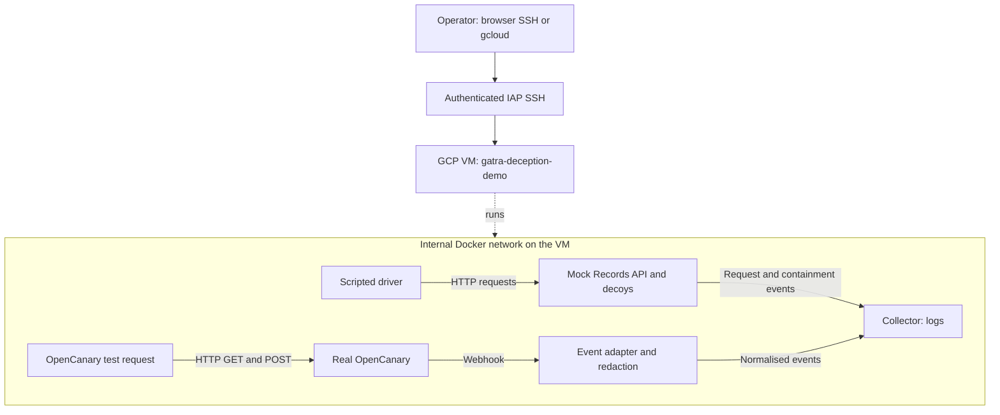

# GATRA Deception Lab: GCP live demo guide

> **Lifecycle update, 13 November 2026:** the lab VM and its boot disk were deleted
> after testing at the user's request. The evidence below is retained. Deploy a
> new lab VM before following the cloud replay instructions.

> This is the original V1 walkthrough. The separate
> [Defense V2 implementation and validation report](VALIDATED-DEFENSE.md) documents
> the subsequent hardening and OpenCanary-to-enforcement work. V1's historical
> results and limitations below remain unchanged.

**Demonstrated:** 13 November 2026 · **Project:** `tantular-dashboard` ·
**Audience:** operators, researchers, and stakeholders learning how deception works.

This guide explains the deployed lab, how to replay it, how to read its output,
and what the observed results establish. It incorporates both the original cloud
execution and the subsequent replay supplied by the operator.

## 1. What this demonstration does

The demo sends actual HTTP requests between running containers on a Google Cloud
VM. A scripted agent tries to retrieve an export from a deliberately vulnerable
Records API. Three configurations show how adding decoys changes that agent's
path. A separate test sends a page request and a login attempt to real OpenCanary
and follows their detection events into a collector.

| Component | What runs | What the result means |
| --- | --- | --- |
| GCP VM and Docker | Actual cloud infrastructure and container processes | The services execute remotely in your project |
| Records API | A mock application with synthetic records and keys | The HTTP traffic is real; the business data and vulnerability are lab fixtures |
| Attacker driver | A deterministic crawler, with no LLM | It demonstrates a known sequence, not autonomous AI reasoning |
| Static deception | Fixed backup file, canary key, and internal API decoys | Following the decoy credential can trigger session denial |
| Adaptive deception | Programmed pagination that offers additional leads | This implementation adapts responses through code, not a defender LLM |
| OpenCanary | Actual HTTP honeypot service | Page views and login attempts generate detection events |
| Adapter and collector | Actual event processing and logging services | Events are normalised, credentials redacted, and delivery observed |

**Two separate control paths exist:** the mock API can deny its own session;
OpenCanary sends alerts to the collector. OpenCanary alerts do not currently
invoke a policy executor, firewall block, or VM quarantine.

## 2. Deployment and architecture

| Setting | Deployed value |
| --- | --- |
| Project | Tantular Dashboard — `tantular-dashboard` |
| VM | `gatra-deception-demo` |
| Zone | Jakarta — `asia-southeast2-a` |
| Machine and OS | `e2-small`, Ubuntu 24.04 LTS |
| Boot disk | 20 GB standard persistent disk; auto-delete on VM deletion |
| VPC / subnet | `gatra-deception-demo-net` / `gatra-deception-demo-subnet` |
| Subnet range | `10.203.0.0/24` |
| Remote working directory | `/opt/deception-lab` |
| Compose project | `gatra-cloud-demo` |
| VM identity | No attached service account or OAuth scopes |
| Operator access | Authenticated SSH through IAP |
| Published application ports | None |
| Scheduled lifetime | VM automatically stops after 3,600 seconds of runtime |

The host has an ephemeral external IP for bootstrap downloads. Application
containers use an internal-only Docker network. The dedicated VPC has no peering
configured by the deployment script. The created ingress rule allows TCP 22
only from IAP's `35.235.240.0/20` range.



Containment in this diagram occurs **inside the Records API**. The collector
records evidence; it does not enforce containment.

## 3. Start or replay the demo

### Option A: Google Cloud Console

1. Open the [lab VM in Tantular Dashboard](https://console.cloud.google.com/compute/instancesDetail/zones/asia-southeast2-a/instances/gatra-deception-demo?project=tantular-dashboard).
2. Check the VM status. If it has automatically stopped, starting it resumes
   billable runtime. If it has been deleted, use the deployment instructions in
   [the GCP README](../cloud/gcp/README.md).
3. Click **SSH** and run:

```bash
sudo bash /opt/deception-lab/cloud/gcp/remote-demo.sh
```

Let all four sections finish. Container recreation, image downloads on the
first run, and isolation probes introduce pauses. The final section prints the
OpenCanary login response and event logs. Successful completion reaches:

```text
Expected: http.get and http.login-attempt, followed by collector events.
OpenCanary alerts are collected only. It does not trigger network containment here.
Decoy containers have no published ports and use the internal-only Docker network.
```

### Option B: Your local terminal

Run from the local `deception-lab/` directory with an authenticated account that
has access to this project:

```bash
export GATRA_GCP_ACCOUNT=you@example.com
bash cloud/gcp/lab.sh demo tantular-dashboard
```

This selects the account for these commands without changing gcloud's saved
default project or account.

### Save a complete replay transcript

In the **VM's SSH terminal**, capture output while replaying:

```bash
set -o pipefail
sudo bash /opt/deception-lab/cloud/gcp/remote-demo.sh 2>&1 \
  | tee "$HOME/deception-demo-$(date -u +%Y%m%dT%H%M%SZ).log"
```

The demo recreates the collector and mock API for each mode. Save the complete
transcript if you need all three scenarios; querying container logs afterward
primarily shows the last mode. OpenCanary and its adapter can retain older logs
across replays.

## 4. Read each scenario

### A. No deception: establish the baseline

Header:

```text
=== REAL HTTP SESSION: deception=none; deterministic driver, synthetic records ===
```

The agent discovers routes through `/robots.txt` and `/api/v1/openapi.json`,
reads the synthetic service key from `/api/v1/debug/env`, and uses it to reach
`/api/v2/records/export`.

Observed verdict fields:

```json
{"stopReason":"submitted","toolCalls":6,"answer":"EXP-A907D09040","tokens":null}
```

The target also reports:

```json
{"type":"objective.served","request":6,"which":"real"}
```

**Interpretation:** the agent reached the intended lab objective. Here, “real”
means the genuine objective within the mock application, rather than its decoy
export. It does not mean production records were accessed.

### B. Static deception: detect canary credential use

At request 3, the agent reads `/backup/config.bak`. This file supplies a synthetic
canary credential. The first decoy interaction produces `decoy.hit` and enables
`throttle_requests`; subsequent HTTP responses are delayed by 250 ms.

The agent continues crawling, including the genuine debug endpoint. At request
8 it tries the canary key against the genuine records export endpoint. The
target identifies the key, records evidence, and terminates its session:

```json
{"type":"canary.used","request":8,"path":"/api/v2/records/export"}
{"type":"containment","request":8,"action":"terminate_session","reason":"canary credential used"}
```

Observed verdict: **8 tool calls, `answer: null`**.

**Interpretation:** the explicit canary and containment events explain the
missing answer. A null answer alone would not prove successful containment.
The key's use is the signal; the endpoint itself does not have to be a decoy.

### C. Adaptive deception: extend engagement, then contain

The same initial decoys are present, but the internal accounts endpoint keeps
offering additional pages, such as `/api/v2/internal/accounts?cursor=2`.
The scripted crawler follows these leads, increasing its decoy interactions.

The observed run reaches the configured threshold of 12 decoy hits at request
17. The API terminates its session:

```json
{"type":"decoy.hit","request":17,"count":12}
{"type":"containment","request":17,"action":"terminate_session","reason":"sustained decoy engagement"}
```

The driver makes request 18, receives the terminated-session response, and
stops without submitting an answer.

**Interpretation:** 18 calls were recorded although termination occurred at
request 17. The extra request observes the denied session. Adaptive deception
caused more engagement in this scripted fixture; the larger call count alone
does not establish better security against other agents.

### D. OpenCanary: trace a real login alert

The final section sends a page request and a synthetic login POST to OpenCanary
inside the Docker network. It prints:

```text
Actual login response: 200
```

HTTP 200 means the honeypot returned a page; it does not establish a successful
login to any genuine account. Look next for:

```json
{"source":"opencanary","logtype":3000,"kind":"http.get"}
{"source":"opencanary","logtype":3001,"kind":"http.login-attempt"}
```

These excerpts omit other event fields for readability. The login event's
credentials section should contain a username hash and:

```json
{"passwordLength":18,"redacted":true}
```

The collector must also show the corresponding event under its `event` field.
That confirms delivery beyond the sensor. The demo checks login-event delivery
and the absence of the submitted password from its collected telemetry output.

## 5. Verified results and operator replay

| Scenario | Calls | Answer | Observed explanation |
| --- | --- | --- | --- |
| None | 6 | `EXP-A907D09040` | Genuine lab export served and submitted |
| Static | 8 | `null` | Canary key used; API session terminated |
| Adaptive | 18 | `null` | 12 decoy hits; session terminated at request 17 |
| OpenCanary | Separate GET/POST test | HTTP 200 | Login event reached collector with credentials redacted |

The operator's subsequent replay reproduced all three driver verdicts and log
heads. It also produced a fresh OpenCanary login event at
**2026-11-13 07:35:10.190027 UTC / 14:35:10.190027 WIB**, received as collector
event **34**. The original cloud execution recorded its login event at
07:32:08 UTC as collector event 36.

These different collector sequence numbers are expected: the collector is
recreated between scenarios. Use timestamps and event content to match the
replay; do not require a fixed collector sequence number.

## 6. Understand the log fields

| Field or message | Meaning |
| --- | --- |
| `sensor: honeypot` | Event originated from the mock Records API |
| `source: opencanary` | Event originated from real OpenCanary |
| `request` | Request count within that mock target instance |
| `collector_seq` | Arrival order at the current collector instance |
| `decoy.hit` and `count` | Interaction with an instrumented decoy and cumulative hit count |
| `canary.used` | A supplied canary credential was actually used |
| `terminate_session` | The mock API denies subsequent requests with HTTP 403 |
| `toolCalls` | HTTP tool invocations by the scripted driver |
| `tokens: null` | No model participated; token consumption is not applicable |
| `logHead` | Final SHA-256 chain digest reported by the driver harness |
| `blocked (ENETUNREACH)` | The probe could not route to that destination |
| `blocked (TimeoutError)` | That probe did not complete within its timeout |
| `guard.absoluteUrl: refused` | The tool guard rejected an absolute external URL |

`logHead` is not a digital signature. Ordinary Docker/collector output is not
itself a signed, hash-chained export. The separate model experiment JSON files
have their own verification workflow.

The same event appears in both honeypot and collector logs because it is printed
at its source and again after forwarding. Do not count those as two attacks.
Forwarding is asynchronous: collector arrival order can differ from source
order, as the replay shows for `decoy.hit` and `throttle_requests` at request 3.

Older OpenCanary events can appear alongside fresh events because its adapter
is not recreated during every replay. In the operator output, 07:32 events are
retained history; the 07:35 login event is the fresh replay. The Docker address
`172.18.0.2` identifies the internal test client, not an internet attacker.

## 7. Observe logs without replaying

Run in the **VM's SSH terminal**:

```bash
sudo docker compose -p gatra-cloud-demo \
  -f /opt/deception-lab/lab/compose.yaml --profile opencanary \
  logs --tail=100 collector honeypot canary-adapter opencanary
```

Add `--follow` to keep watching, then press **Ctrl+C** to stop viewing. This does
not shut down the containers. To show only login alerts:

```bash
sudo docker compose -p gatra-cloud-demo \
  -f /opt/deception-lab/lab/compose.yaml --profile opencanary \
  logs --no-color collector canary-adapter | grep '"kind":"http.login-attempt"'
```

You can also use `bash cloud/gcp/lab.sh logs tantular-dashboard` from the local
repository with `GATRA_GCP_ACCOUNT` set as shown earlier.

## 8. Presenter notes

| Moment | Show | Explain |
| --- | --- | --- |
| Introduction | Correct GCP project and VM | “These services run in our cloud project; all records and credentials are synthetic.” |
| Baseline | `objective.served` and submitted answer | “The known weakness is reachable when the scripted agent follows the genuine path.” |
| Static | `canary.used`, then `terminate_session` | “Using the planted key gives an explicit signal and triggers application-level denial.” |
| Adaptive | Cursor paths, hit count 12, 18 calls | “Additional leads consume this crawler's effort until the configured engagement threshold.” |
| OpenCanary | Fresh login timestamp in adapter and collector | “A real honeypot produced an alert, and we observed its delivery with credentials redacted.” |
| Limits | Scripted driver and separate model results | “This explains the mechanism. It does not establish effectiveness against arbitrary AI attackers.” |

## 9. What the demo does not prove

- It does not test a production application, production credential, or live
  internet attacker. The mock application's weakness is intentionally present.
- The cloud driver is not an LLM. Adaptive pagination is programmed behavior.
- API session termination is not a network firewall block, host quarantine,
  identity revocation, or OpenCanary-triggered response.
- Cloud events currently go to container stdout, not a configured Cloud Logging
  or SIEM integration. Retain transcripts before deleting the VM.
- Three egress probes show those attempts failed; they do not by themselves
  prove universal isolation. A separate **local Docker validation** passed
  60/60 checks; that result is not a claim that the full validator ran on GCP.
- The separate live local Tantular Cyber test bypassed both decoy configurations
  and reached the genuine lab export. Its baseline timed out. With one session
  per mode, that is an exploratory finding, not a comparative success-rate study.

See the [live-model report](evidence/2026-11-13-live-test.md) for those results.

## 10. Troubleshooting

| Symptom | Check and action |
| --- | --- |
| VM is stopped | Check its status in Console. The deployed VM has a one-hour automatic stop policy. Starting it resumes charges. |
| Wrong project or account | Use `--project=tantular-dashboard` and the intended `--account`; the browser and CLI can be signed into different accounts. |
| IAP or public-key error immediately after creation | Allow first-boot and OS Login setup to complete. If persistent, inspect identity/IAP/OS Login permissions and startup logs; do not open public SSH to work around it. |
| First run pauses while pulling images | Allow downloads and extraction to finish. Subsequent runs reuse downloaded images. |
| `answer: null` | Find `canary.used` or `containment` evidence. Null by itself is not a pass. |
| Repeated old login alerts | Compare `localTime` to the replay time; retained adapter logs include earlier runs. |
| `Actual login response: 200` but no fresh collector alert | Inspect adapter and collector logs. Look for `collector unreachable` and verify the fresh timestamp appears at both stages. |
| Missing earlier scenario logs | The collector and mock API were recreated. Use the complete replay transcript rather than only final container logs. |
| `tokens: null` | Expected for the scripted driver; it is not a model instrumentation failure. |

## 11. Stop and clean up

The original VM was configured to stop approximately **15:28 WIB on 13 November
2026**. This is a historical deployment detail, not a current status report.
Stopping the VM leaves its disk in place and does not remove all charges.

After saving needed evidence, run from the **local `deception-lab/` directory**:

```bash
export GATRA_GCP_ACCOUNT=you@example.com
bash cloud/gcp/lab.sh cleanup tantular-dashboard
```

This removes the named lab VM and its auto-deleted boot disk, IAP firewall rule,
subnet, and VPC. It leaves APIs enabled. If deployment was only partially
completed, the cleanup script can stop when a named resource is missing; inspect
the error and remove remaining named lab resources individually.

## 12. Evidence and source files

| Artifact | Purpose |
| --- | --- |
| [Cloud execution record](evidence/2026-11-13-gcp-test.md) | Original deployment observations and execution caveat |
| [Saved cloud service logs](evidence/2026-11-13-gcp-events.txt) | Original adaptive scenario and OpenCanary delivery evidence |
| [VM configuration snapshot](evidence/2026-11-13-gcp-vm.json) | Captured identity, network, disk, and stop-policy settings |
| [Local model findings](evidence/2026-11-13-live-test.md) | Actual Tantular Cyber run, bypasses, and limitations |
| [Deployment README](../cloud/gcp/README.md) | Provisioning, project selection, and lifecycle commands |
| [Demo script](../cloud/gcp/remote-demo.sh) | Exact remote scenario sequence and OpenCanary assertions |
| [Target implementation](../lab/services/target.mjs) | Mock routes, throttling, canary checks, and engagement threshold |
| [Driver implementation](../lab/services/agent-scripted.mjs) | Deterministic crawl and credential-selection strategy |
| [OpenCanary adapter](../lab/services/canary-adapter.mjs) | Event normalisation and credential redaction |

Evidence is scoped to its recorded run. Current VM status, later alerts, and
later configuration changes must be checked separately.
